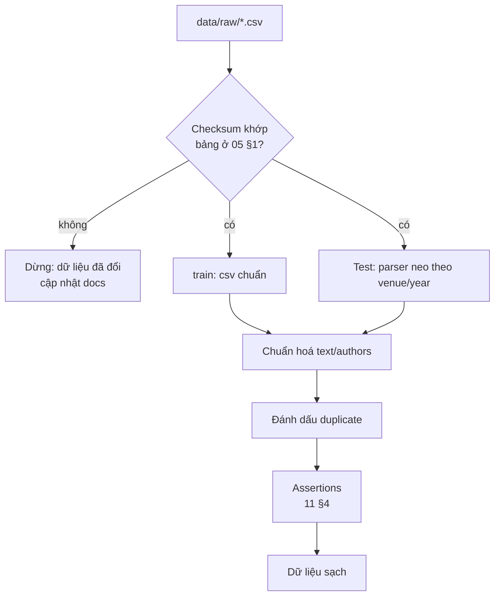

# 07 — Xử lý dữ liệu

Tài liệu này ghi lại **các dữ kiện đã kiểm chứng** về cách đọc và làm sạch dữ liệu, kèm một cách đọc `Test.csv` đã kiểm chứng
để **tham khảo**. Mỗi người tự quyết định cách xử lý dữ liệu trong lời giải của mình. Công cụ đối chiếu: `tools/inspect_data.py`.



## 1. Đọc `train.csv`

File train chuẩn RFC 4180, nên đọc bằng `csv.reader` hoặc `pandas.read_csv` mặc định đều được.
Đã kiểm tra: cả 2,494 dòng đều có đúng 7 field. **[Xác minh]**

## 2. Parse `Test.csv`

**Vấn đề:** cả `title` và `authors` đều có thể chứa dấu phẩy không được quote. Vì vậy **không thể** đọc theo vị trí cột cố định.
`pandas.read_csv` mặc định sẽ báo lỗi hoặc lệch cột tùy tham số, còn `csv.reader` cho ra từ 6 đến 16 field mỗi dòng.

**Một cách đọc đã kiểm chứng (tham khảo, không bắt buộc) [Xác minh: đọc đúng 596/596 dòng, 0 dòng lỗi].** Cách này dựa trên ba quan sát:

1. `id` luôn là field đầu tiên.
2. `doi` luôn là field cuối cùng, vì giá trị `doi` không chứa dấu phẩy.
3. `venue` luôn là một trong 5 giá trị viết thường đã biết, và theo ngay sau là `year` có 4 chữ số.

Mỗi dòng có **đúng một** vị trí `i ≥ 2` thỏa điều kiện thứ 3. Từ vị trí đó:
`title = ",".join(f[1:i])` và `authors = ",".join(f[i+2:-1])`.

```python
import csv, re

VENUES = {"kr", "cav", "lics", "iclp", "lpnmr"}

def parse_test(path):
    with open(path, encoding="utf-8", newline="") as fh:
        rows = list(csv.reader(fh))
    header, body = rows[0], rows[1:]
    assert header == ["id", "title", "venue", "year", "authors", "doi"]
    out = []
    for f in body:
        idx = [i for i in range(2, len(f) - 2)
               if f[i] in VENUES and re.fullmatch(r"\d{4}", f[i + 1])]
        if len(idx) != 1:
            raise ValueError(f"Ambiguous/invalid row: {f[:3]}...")   # không đoán; dừng hẳn
        i = idx[0]
        out.append({
            "id": int(f[0]),
            "title": ",".join(f[1:i]),
            "venue": f[i],
            "year": int(f[i + 1]),
            "authors": ",".join(f[i + 2:-1]),   # sẽ được chuẩn hoá ở bước 3
            "doi": f[-1],
        })
    assert len(out) == 596 and len({r["id"] for r in out}) == 596
    return out
```

Lưu ý:
- **[Xác minh]** `Test.csv` không chứa chuỗi `", "` nào. Host đã bỏ mọi khoảng trắng sau dấu phẩy, nên title sau khi ghép
  có dạng `"...ORBITS: Algorithms,Implementation,and Experiments."`. Train thì giữ `", "` (169 title).
  Muốn so sánh title giữa hai file thì cần tính đến khác biệt này (xem mục 3).
- Nếu host sửa file (thêm quote cho đúng chuẩn), thuật toán này **vẫn chạy đúng**, vì khi đó mỗi dòng có đúng 6 field và
  `i = 2`. Tuy vậy, checksum sẽ thay đổi.
- Sau khi parse, kiểm tra: venue ∈ {cav: 221, lics: 187, kr: 151, lpnmr: 37}, year nằm trong 2016–2025, 41 bài có authors rỗng.
- **Kiểm tra ranh giới field** (audit 2026-11-11, **[Xác minh]**): field cuối luôn là DOI/URL; author token không chứa chữ số,
  không trùng tên venue, không có hậu tố tên bị tách. Chi tiết và giới hạn: [test-csv-notes](../.claude/skills/dataset-integrity/references/test-csv-notes.md).
  Script đối chiếu: `tools/inspect_data.py`.

## 3. Các vấn đề cần chuẩn hoá (cách xử lý chỉ để tham khảo)

| Bước | Áp dụng cho | Cách làm | Lý do |
|---|---|---|---|
| Decode HTML entities | `title`, `authors` | `html.unescape` | Q4 trong [05 §6](05-dataset-overview.md#6-vấn-đề-chất-lượng-dữ-liệu) |
| Tách authors | `authors` | `[a.strip() for a in s.split(",") if a.strip()]` | Thống nhất format của train và test (Q6) |
| Khôi phục dấu phẩy (chỉ test) | `title` | `re.sub(r",(?=\S)", ", ", title)` | Q1b, thống nhất format với train |
| `title_norm` | `title` | `" ".join(re.sub(r"[^a-z0-9]+", " ", html.unescape(t).lower()).split())` | Phát hiện duplicate. **Thay bằng khoảng trắng chứ không xoá**, để `"a,b"` không bị dính thành `"ab"` |
| Bỏ dấu `.` cuối title | `title` | Tùy chọn khi tokenization | 97% title kết thúc bằng `.` nên dấu này không mang thông tin |

Khi chuẩn hoá **không được** ghi đè lên file gốc (xem [AGENTS.md](../AGENTS.md)).

## 4. Duplicate và các bài liên quan

| Trường hợp | Số lượng (train) | Lưu ý |
|---|---|---|
| Cùng `title_norm` | 6 nhóm, 16 dòng (một nhóm 6 dòng "Front Matter…", còn lại là các cặp) | Nếu các bản trùng rơi vào cả phần train lẫn phần validation, điểm validation sẽ lạc quan hơn thực tế |
| Cùng `title_norm`, label khác nhau | 2 nhóm (110/122; 273/1341) | Nhiễu nhãn tự nhiên; đáng nêu trong báo cáo (rubric tiêu chí 3) |
| Cùng `doi` nhưng title khác | Có (ví dụ id 33/142, 1423/1512, 1533/1716 là các phiên bản của cùng một công trình) | Bài liên quan, **không** phải duplicate tuyệt đối |
| `doi` dùng chung cho rất nhiều bài (ceur-ws, 25 bài) | 1 giá trị | Thực chất là **placeholder**, không phải định danh |
| Front matter / proceedings | Khoảng 69 bài khớp từ khoá | Thống kê label ở [05 §4](05-dataset-overview.md#theo-đặc-điểm-title-train) |

Train và test không có title chung. 3 giá trị `doi` trùng giữa train và test thuộc các bài khác nhau
(id test 896, 1372, 3077). **Không được** dùng chúng để "chép" label sang test.

## 5. Leakage checklist

- [ ] Mọi thống kê dùng `Label` (mean theo venue, author, keyword) đều được tính **trong fold**.
- [ ] Các bài duplicate hoặc liên quan nằm cùng một fold.
- [ ] **Không dùng `id`, vị trí trong file, hay thứ hạng của `id` trong nhóm (venue, year) làm feature** cho đến khi Q-10 được trả lời.
      `id` mã hoá venue + year, **và** có tương quan âm với label bên trong mỗi nhóm (z ≈ −4.6, [05 §3](05-dataset-overview.md#3-kích-thước-và-phân-chia)).
      Đây là artifact của cách dựng dataset, không phải đặc điểm của bài báo. Nếu được phép dùng thì phải công khai trong báo cáo.
- [ ] Không vô tình dùng thứ tự `id` qua tie-break: priority hằng số sẽ sắp theo `id` dạng text ([08 §1](08-methodology.md#các-tính-chất-quan-trọng)).
- [ ] Không dùng thông tin nào từ Public LB làm feature hay label (INT-03).
- [ ] Nếu fit representation trên test, ghi rõ trong README và báo cáo (NFR-05).
