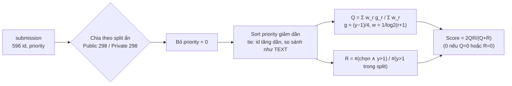

# 08 — Phương pháp luận

> Mục 1 phân tích **công thức metric chính thức** (mức [Xác minh] về mặt toán học) và các mốc tham chiếu đã tính.
> Mục 2 liệt kê **ràng buộc** từ requirements. Tài liệu này **không** đề xuất thuật toán, model hay feature nào.

## 1. Phân tích metric

Nguồn: [evaluation](reference/competition-pages/evaluation.md). Mục này giả định định nghĩa Coverage trong EV là đúng,
vì vẫn còn mâu thuẫn **C-01** ([02 §5](02-requirements.md#5-mâu-thuẫn-giữa-các-nguồn-chưa-giải-quyết)).

### Các tính chất quan trọng

1. **Q là trung bình có trọng số của gain**, không được normalize theo ranking lý tưởng như nDCG.
   Một danh sách sắp hoàn hảo vẫn có Q < 1 nếu chứa bài label < 5.
2. **Thêm một bài vào cuối danh sách** (vị trí m+1, trọng số w = 1/log2(m+2), gain g):
   - Q mới = (ΣwG + w·g) / (ΣW + w), nên **Q giảm khi và chỉ khi g < Q hiện tại**.
   - R tăng thêm 1/P nếu bài đó có y > 1 (P là số bài worthwhile trong split). Nếu y = 1 thì R không đổi.
   - Đạo hàm của harmonic mean: ∂S/∂Q = 2R²/(Q+R)² và ∂S/∂R = 2Q²/(Q+R)².
     Vì vậy, khi R đã cao mà Q thấp, tăng Q có lợi hơn, và ngược lại.
   - **Hệ quả:** bài label 1 không bao giờ có lợi, vì nó chỉ kéo Q xuống mà không tăng R. Bài label 2 (g = 0.25) làm giảm Q
     nếu Q > 0.25, nhưng làm tăng R. Như vậy giữa selection và Q/R có một đánh đổi phụ thuộc vào dữ liệu.
3. **Trọng số vị trí giảm theo log**: w₁ = 1, w₂ ≈ 0.631, w₁₀ ≈ 0.289, w₁₀₀ ≈ 0.150. Đầu danh sách quan trọng nhất,
   nhưng phần đuôi vẫn có trọng số đáng kể. Selection (chọn bài nào) và ordering (xếp thứ tự) đều ảnh hưởng đến kết quả.
4. **Tie-break theo id dạng text**: ví dụ `"1000" < "713" < "9"`. Nếu dùng priority rời rạc (ví dụ dự đoán nhãn nguyên 1–5)
   thì thứ tự bên trong mỗi nhóm bằng nhau được quyết định bởi tie-break này, không phải bởi model.
5. **Hai split được tính độc lập** và chỉ có 298 bài mỗi split. Vì membership bị ẩn, cùng một thứ tự toàn cục
   được dùng cho cả hai split.
6. **R chỉ phụ thuộc tập được chọn**, không phụ thuộc thứ tự. **Q phụ thuộc cả tập được chọn lẫn thứ tự.**

### Các mốc tham chiếu đã tính **[Xác minh]**

Tính bằng `python tools/score.py bounds --train data/raw/train.csv` (seed 0, 200 subset × 298 label lấy từ **train**).
Đây **không phải** điểm trên test.

| Mốc | Loại | Score (mean ± std) | Q | R |
|---|---|---:|---:|---:|
| Chọn tất cả, thứ tự ngẫu nhiên | Đạt được | 0.526 ± 0.023 | 0.357 | 1.000 |
| Chọn tất cả, priority hằng số (tie-break theo id dạng text) | Đạt được | 0.532 ± 0.023 | 0.363 | 1.000 |
| Chọn tất cả, sắp theo label thật | **ORACLE: dùng nhãn thật, không đạt được** | 0.623 ± 0.017 | 0.452 | 1.000 |
| Bỏ label 1, sắp theo label thật | **ORACLE: không đạt được** | 0.780 ± 0.014 | 0.639 | 1.000 |

- Mốc ORACLE **không phải baseline**. Nó chỉ cho thấy phần đóng góp tối đa về lý thuyết của ordering và của selection.
- Std khoảng 0.014–0.023 giữa các subset 298 bài cho biết **mức nhiễu** khi so sánh hai kết quả, và khi đọc Public LB (cũng 298 bài) **[Suy luận]**.
- Public LB (2026-11-11): hai entry "baseline" 0.66962 / 0.60953 (Q-03), top 0.68281. Đây là quan sát công khai, không tái lập được.

## 2. Ràng buộc từ requirements khi thiết kế lời giải

Đây là các **ràng buộc**, không phải gợi ý thiết kế. Thiết kế cụ thể do mỗi người tự quyết định.

- **FR-04:** phải dùng **thực chất** ít nhất một phương pháp đã học: classification, regression, clustering, hoặc itemset/association rules.
  Được kết hợp với kỹ thuật khác. Báo cáo phải giải thích phương pháp đó góp vào priority như thế nào (Rules §2).
- **Rubric tiêu chí 6:** phải so sánh với **một baseline** trong cùng điều kiện, và phân tích Q, R cùng các lỗi điển hình.
  Rules không quy định baseline nào; mỗi người tự chọn và tự biện minh.
- **NFR-02/NFR-04:** so sánh trên cùng partition; không dùng việc tune trên Public LB làm bằng chứng.
- **NFR-05/NFR-06:** dùng metadata của test theo cách unsupervised, hay dùng dữ liệu ngoài hoặc pretrained model, thì phải công khai và trích dẫn.
- Thang `priority` tùy ý; Kaggle khuyến nghị `[0, 10]` (EV).
