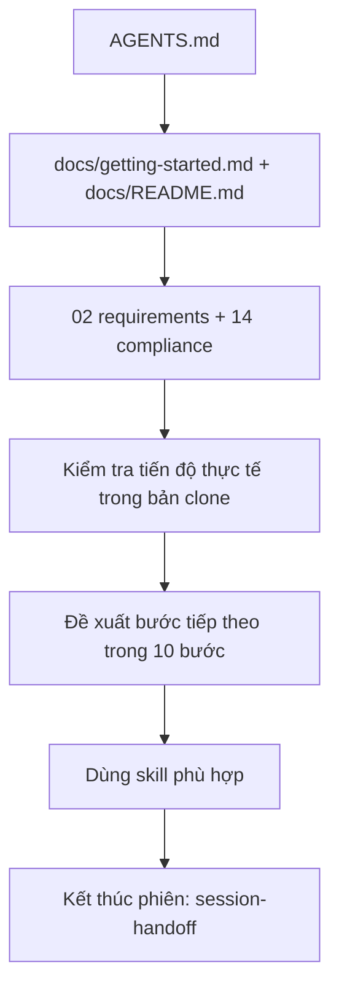

# Onboarding cho agent

Mục tiêu: một agent mới, **không có lịch sử chat**, mở bản clone của **một** sinh viên và giúp sinh viên đó làm bài trong khoảng 10 phút.
Cách nhanh nhất là chạy skill `assignment-onboarding`. Skill đó làm theo đúng các bước dưới đây.

## Bước 1: Đọc
1. [AGENTS.md](../../AGENTS.md): repo này là gì; những việc bạn được và không được làm.
2. [getting-started.md](../getting-started.md) và [docs/README.md](../README.md).
3. [02-requirements.md](../02-requirements.md) (FR/NFR/INT/TEAM, mâu thuẫn C-01..C-06) và [14](../14-compliance-and-distribution.md).

Tài liệu chuyên đề, đọc theo việc đang làm:

| Việc | Đọc thêm | Skill |
|---|---|---|
| Dữ liệu | [05](../05-dataset-overview.md), [06](../06-data-dictionary.md), [07](../07-data-processing.md) | `dataset-integrity` |
| Metric, validation | [08](../08-methodology.md), [11](../11-testing-evaluation.md) | `validation-and-scoring` |
| Thí nghiệm | [08 §2](../08-methodology.md#2-ràng-buộc-từ-requirements-khi-thiết-kế-lời-giải), [templates/experiment-log.md](../templates/experiment-log.md) | `independent-experiment`, `experiment-comparison` |
| Nộp bài | [11 §3](../11-testing-evaluation.md#3-validator-cho-submission), [12](../12-reproducibility.md), [10 §4](../10-development-guide.md#4-nộp-bài-lên-kaggle) | `submission-management` |
| Kaggle, luật | [integrations](../integrations/kaggle-mcp-setup.md), [reference/](../reference/competition-pages/README.md) | `kaggle-research` |
| Môi trường, git, tools | [10](../10-development-guide.md), [04](../04-repository-structure.md), [tools/](../../tools/README.md) | — |
| Báo cáo | [02 §4](../02-requirements.md#4-rubric-báo-cáo-r), [12](../12-reproducibility.md) | — |

## Bước 2: Xác định tiến độ thực tế
Kiểm tra bản clone: có `data/raw/` chưa, có `src/`, `experiments/EXPERIMENTS.md`, `submissions/LOG.md` chưa, có handoff của phiên trước không
(`docs/handoffs/` hoặc vị trí sinh viên chọn). Đọc `git log --oneline -10` nếu đã có commit.
**Code và log trong bản clone là nguồn sự thật về tiến độ của sinh viên.**

## Bước 3: Đề xuất và làm
- Đề xuất **một** bước tiếp theo trong [10 bước](../getting-started.md). Khi sinh viên đồng ý thì làm, dùng skill phù hợp.
- Bạn **được** viết code và commit cục bộ khi sinh viên yêu cầu. Push thì chỉ push lên repo riêng của sinh viên, và chỉ khi được yêu cầu.

## Bước 4: Kết thúc phiên
Viết handoff bằng skill `session-handoff` ([session-handoff-template.md](session-handoff-template.md)).

## Không bao giờ
- Commit hoặc in Kaggle token.
- Nộp bài, tạo hay đổi team, chấp nhận lời mời trên Kaggle. Sinh viên tự làm.
- Push lên repo nhóm khi chưa được yêu cầu; chia sẻ code hay data ra ngoài nhóm 5 người ([14](../14-compliance-and-distribution.md)).
- Sửa `data/raw/` hay CSV đã nộp; sửa file trong `docs/reference/`.
- Báo "đã chạy/đã test" khi thực tế chưa chạy.

## Kiểm tra nhanh sau khi sửa docs hoặc skills
- Mọi link Markdown tương đối, kể cả `#anchor` theo slug kiểu GitHub, đều trỏ tới file hoặc heading có thật.
- Mỗi `.claude/skills/<name>/SKILL.md` có frontmatter YAML với `name` trùng `<name>` (định dạng `a-z0-9-`, 1–64 ký tự)
  và `description` từ 1 đến 1024 ký tự, không chứa chuỗi `": "` nếu không được quote.
- Không có token: `grep -rE "KGAT_[0-9a-f]{8,}" .` không được trả về kết quả nào.
